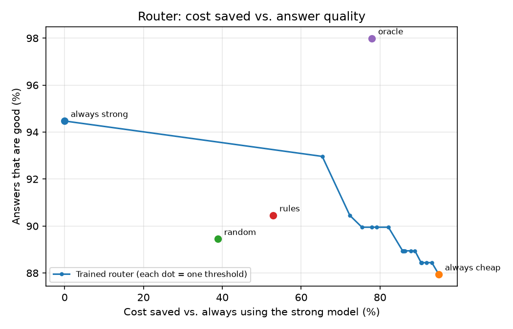
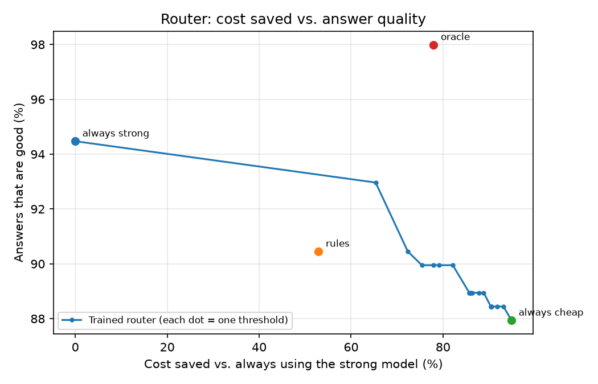
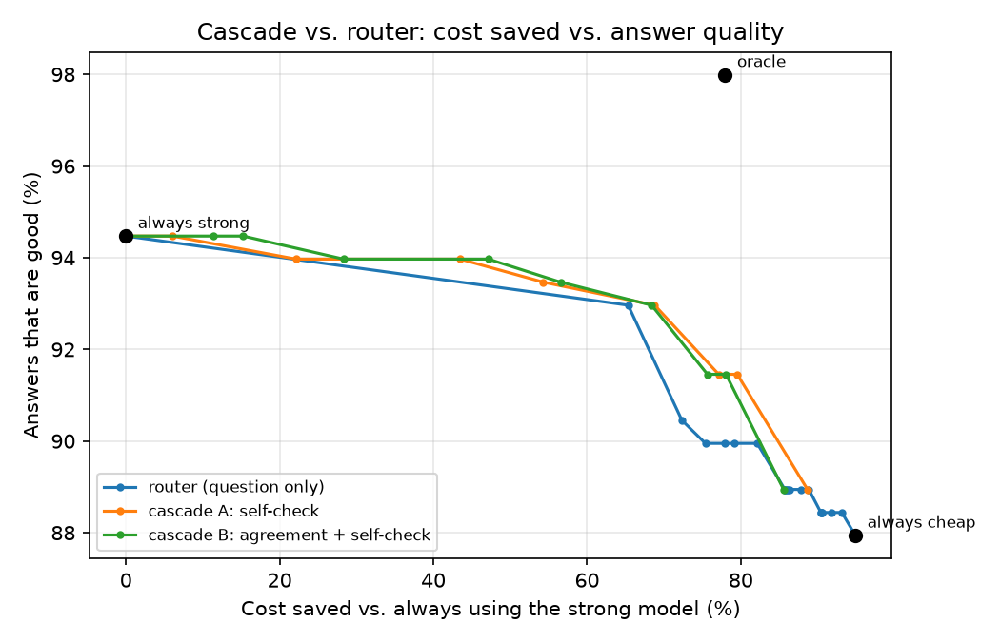
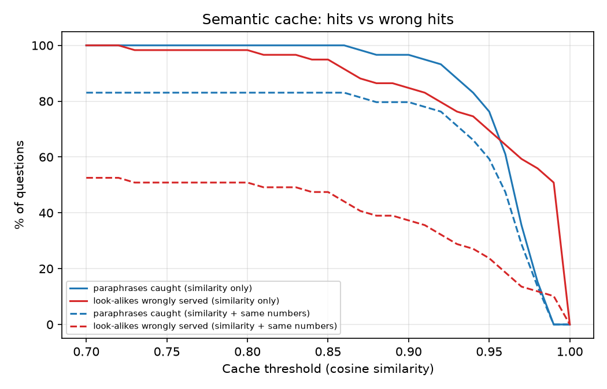

# llm-gateway

# LLM Gateway

A smart gateway that sits between an app and AI models and cuts LLM costs by:

- **Routing** each question to the cheapest model that can answer it well
- **Caching by meaning**, so repeated questions with different wording are answered instantly for free
- **Checking quality** and falling back to a stronger model when a cheap answer looks wrong
- **Tracking** cost, speed and quality on a live dashboard

## Status

Work in progress. Building step by step, with the results measured at each stage.

## Tech stack

Python, FastAPI, Ollama (local model), Postgres + pgvector, scikit-learn, Streamlit, Docker

## Setup

    python -m venv .venv
    .venv\Scripts\activate
    pip install -r requirements.txt
    copy .env.example .env
## Baseline (before routing and caching)

Every request goes to a single local model (llama3.2 via Ollama).

| Metric | Value |
|---|---|
| Requests | 14 |
| Success rate | 92.9% |
| Average latency | 49550 ms |
| p95 latency | 91810 ms |
| Cost | $0 (local model) |

Measured on 10/24/2026. Later milestones compare against these numbers.

## Usage

Choose which model answers with `tier` (default: `cheap`):

    {"question": "What is 17 x 23?"}
    {"question": "Prove that 17 is prime", "tier": "strong"}

## Datasets

- [GSM8K](https://github.com/openai/grade-school-math) (MIT license): grade-school math word problems
- [Dolly 15k](https://huggingface.co/datasets/databricks/databricks-dolly-15k) (CC BY-SA 3.0): everyday requests written by people

`python -m scripts.build_dataset` builds a fixed, repeatable sample of 200 questions in `data/questions.jsonl`.

Then open http://localhost:8000/docs to send a question to `/ask`.

## Running tests

## Results so far

On 200 questions (100 GSM8K math, 100 Dolly everyday requests):

| | Local llama | Claude Sonnet |
|---|---|---|
| Good enough / correct | [34]% | 89]% math accuracy |
| Average response time | [31.5] s | [3.7] s |
| Cost for 200 questions | $0 | $[0.728] |

- The free model was good enough on [34]% of questions, so a router could send those away from the paid model.
- Claude-as-judge agreed with my own grading on [47]% of a 20-answer sample.

### Router (first attempt)

- Approach: logistic regression on question embeddings (nomic-embed-text), scored with 5-fold cross-validation on 200 labeled questions.
- Result: cross-validated ROC AUC of **[AUC]**, so the trained router does **not yet beat random routing**. At about 40% cost saved, it gives about 65% good answers, versus about 69% for random.
- Baselines:
  - Always strong: about 95% good answers at full cost
  - Random: saves about 41% at about 69% good answers
  - Hand-written rules: saves about **56%** at about **68%** good answers, the best practical strategy so far
  - Perfect routing (oracle, not achievable): saves about **26%** with about **95%** good answers. About a quarter of the cost could be saved with no quality loss, if a router could pick the right questions.
- Why the router struggles: 200 examples is too few for 768-number embeddings (overfitting), and question difficulty is subtler than topic.
- Next: stronger regularization, adding simple features (length, number count, category), and more labeled data.
- Quality assumes the strong model is correct on everyday questions, since those weren't graded.

## Router v2: Claude Haiku as the cheap model

With llama3.2:1b as the cheap model, no router could beat simple rules (the cheap model was good enough on only 34% of questions). Switching the cheap tier to **Claude Haiku** changed that. Only `.env` changed; the gateway code didn't.

| | llama3.2:1b | Claude Haiku |
|---|---|---|
| Cheap model good enough | 68/200 (34%) | **175/199 (88%)** |
| Math (100 questions) | 41% | **89%**, the same as Sonnet (89/100) |
| Everyday questions | 27% | **87%** |

Strategies on 199 graded questions (costs use list prices per million tokens):

| Strategy | Sent to cheap | Quality | Cost | Saves |
|---|---|---|---|---|
| Always Sonnet | 0% | 94.5% | $0.718 | 0% |
| Always Haiku | 100% | 87.9% | $0.037 | 95% |
| Random | 39% | 89.4% | $0.439 | 39% |
| Hand-written rules | 37% | 90.5% | $0.338 | 53% |
| Oracle (perfect routing, impossible) | 88% | **98.0%** | $0.158 | 78% |

- **The trained router works now.** Scaled question embeddings plus logistic regression reach a cross-validated **AUC of 0.735** (llama: 0.46) and clearly beat the rules at the same quality.
- **The hand-written rules went stale.** They send every math question to Sonnet, which made sense with llama but wastes money now that Haiku matches Sonnet on math. The trained router learned this from the data.
- **Perfect routing beats always using Sonnet** (98% vs 94.5%), because Haiku sometimes gets right what Sonnet gets wrong.

## Cascade vs router

A **router** decides from the question alone, before any model call. A **cascade** answers with Haiku first, checks the answer, and escalates to Sonnet only if the check fails.

- **Cascade A (self-check):** Haiku rates its own answer from 0 to 100, without seeing the reference answer.
- **Cascade B (agreement + self-check):** for math, Haiku answers twice and the final numbers are compared; other questions use the self-check.

Cost saved compared with always using Sonnet, at a given maximum quality loss:

| Quality you give up | Router | Cascade A | Cascade B |
|---|---|---|---|
| None | 0% | 6% | **15%** |
| ≤1% | 0% | 43% | **47%** |
| ≤3% | 65% | **69%** | 68% |
| ≤5% | **82%** | 80% | 78% |

**Findings**
- **When quality must stay within 1% of Sonnet, only the cascade saves money (about 45%)**, because it can see the answer. When 3–5% loss is acceptable, router and cascade tie.
- **Haiku partly knows when it's wrong:** its self-check scored below 90 on 18 of its 24 wrong answers, but it also doubts many correct answers.
- **Asking twice barely helps for math:** the two answers disagreed on only 3 of 11 wrong ones. The model's errors are systematic, so it repeats the same mistake.
- **Checks have costs:** the self-check roughly doubles the Haiku spend, and the cascade adds latency (up to three calls in a row), while the router adds almost none.

**Limitations**
- Only 199 questions and 24 Haiku failures, so differences of a few percent are 1–2 questions (noise).
- Sonnet's everyday answers are assumed correct (only its math is checked), which slightly flatters "always Sonnet".
- The LLM judge (Sonnet) is somewhat strict; a human review of a sample agreed with it 47% of the time, with every disagreement being a case the judge failed.
- Prices are from `app/pricing.py` and should be confirmed on the official pricing page.

## Live replay

All 199 questions sent through the running gateway in each mode (4 at a time; 0 errors out of 398 requests).

| | Cascade (threshold 85) | Router (threshold 0.95) |
|---|---|---|
| Answered by Haiku | 71% | 87% |
| Quality | **92.0%** | 97.0%* |
| Saves vs always Sonnet | **41%** | 79%* |
| Calls per question | 2.29 | 1.00 |
| Avg / p95 latency | 5.3 s / 15.4 s | 5.2 s / 10.3 s |

\* **Not a valid result.** The router was trained on these same questions, so it nearly reproduces perfect routing (98%, 78%). Its honest, cross-validated estimate is about 65% savings at at most 3% quality loss. A held-out test set is next.

- **The cascade's live results matched the offline estimate** (94.0% quality, 43% savings), within about 4 questions.
- **Escalation is slow:** escalated requests make three calls in a row (avg 11.5 s, p95 17 s).
- **Local embeddings are a bottleneck:** the router's single call was slower than the cascade's two, because embeddings are computed in Ollama on a laptop CPU. A hosted embedding model would remove most of that delay.

## Held-out test (the fair comparison)

The router was trained on the main 199 questions, and the cascade threshold was chosen on them, so a fair test needs new questions. `scripts/build_holdout.py` picks 100 fresh ones (50 math, 50 everyday) from the same datasets, with zero overlap.

| Strategy | Quality | Saves vs always Sonnet | Calls per question | p95 latency |
|---|---|---|---|---|
| Always Sonnet | 94.0% | 0% | 1 | n/a |
| **Router (threshold 0.95)** | **94.0%** | **64%** | 1.00 | 13.1 s |
| Cascade (threshold 85) | 94.0% | 46% | 2.24 | 16.4 s |
| Always Haiku | 92.0% | 95% | 1 | n/a |
| Oracle (perfect routing) | 97.0% | 84% | n/a | n/a |

- **The router generalizes:** 64% savings on unseen questions, matching its cross-validated estimate (65%). The 79% seen in the main-set replay was data leakage.
- **At equal quality, the router beats the cascade:** more savings, one call instead of 2.24, and a better worst case. The router is now the default; the cascade is the automatic fallback.
- **The cheap model alone is a strong baseline here:** always Haiku was only 2 points (2 questions) below Sonnet. The benefit of routing grows with how often the cheap model fails.
- With 100 questions, differences of 1–2 points are within noise.

## Semantic cache: why a similarity threshold isn't enough

To choose the cache threshold from data, Sonnet wrote a paraphrase (same answer) and a look-alike (one detail changed, so the answer differs) for 59 questions; 10 were spot-checked by hand (10/10 correct). Each was looked up against a cache of the originals.

| Median similarity to the original | Math | Everyday |
|---|---|---|
| Paraphrase (should be served) | 0.969 | 0.951 |
| Look-alike (must not be served) | **0.999** | 0.939 |

- **No threshold is safe.** At 0.98 the cache catches only 15% of paraphrases but serves 56% of look-alikes. Changing one number leaves every other word in place, so the embedding barely moves.
- **A "same numbers" rule halves wrong hits** (85% → 37% at 0.90), but it blocks paraphrases that write numbers as words and can't see changes written in words.
- **Embeddings measure topic, not answer.** The semantic cache is off by default until it has a verifier that checks whether two questions really have the same answer.

