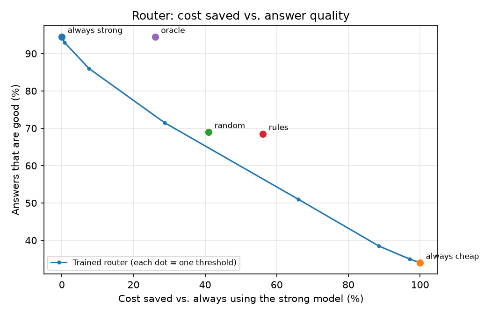

# llm-gateway

# LLM Gateway

A smart gateway that sits between an app and AI models and cuts LLM costs by:

- **Routing** each question to the cheapest model that can answer it well
- **Caching by meaning**, so repeated questions with different wording are answered instantly for free
- **Checking quality** and falling back to a stronger model when a cheap answer looks wrong
- **Tracking** cost, speed and quality on a live dashboard

## Status

Work in progress. Building step by step, with the results measured at each stage.

## Tech stack

Python, FastAPI, Ollama (local model), Postgres + pgvector, scikit-learn, Streamlit, Docker

## Setup

    python -m venv .venv
    .venv\Scripts\activate
    pip install -r requirements.txt
    copy .env.example .env
## Baseline (before routing and caching)

Every request goes to a single local model (llama3.2 via Ollama).

| Metric | Value |
|---|---|
| Requests | 14 |
| Success rate | 92.9% |
| Average latency | 49550 ms |
| p95 latency | 91810 ms |
| Cost | $0 (local model) |

Measured on 10/24/2026. Later milestones compare against these numbers.

## Usage

Choose which model answers with `tier` (default: `cheap`):

    {"question": "What is 17 x 23?"}
    {"question": "Prove that 17 is prime", "tier": "strong"}

## Datasets

- [GSM8K](https://github.com/openai/grade-school-math) (MIT license): grade-school math word problems
- [Dolly 15k](https://huggingface.co/datasets/databricks/databricks-dolly-15k) (CC BY-SA 3.0): everyday requests written by people

`python -m scripts.build_dataset` builds a fixed, repeatable sample of 200 questions in `data/questions.jsonl`.

Then open http://localhost:8000/docs to send a question to `/ask`.

## Running tests

## Results so far

On 200 questions (100 GSM8K math, 100 Dolly everyday requests):

| | Local llama | Claude Sonnet |
|---|---|---|
| Good enough / correct | [34]% | 89]% math accuracy |
| Average response time | [31.5] s | [3.7] s |
| Cost for 200 questions | $0 | $[0.728] |

- The free model was good enough on [34]% of questions, so a router could send those away from the paid model.
- Claude-as-judge agreed with my own grading on [47]% of a 20-answer sample.

### Router (first attempt)

- Approach: logistic regression on question embeddings (nomic-embed-text), scored with 5-fold cross-validation on 200 labeled questions.
- Result: cross-validated ROC AUC of **[AUC]**, so the trained router does **not yet beat random routing**. At about 40% cost saved, it gives about 65% good answers, versus about 69% for random.
- Baselines:
  - Always strong: about 95% good answers at full cost
  - Random: saves about 41% at about 69% good answers
  - Hand-written rules: saves about **56%** at about **68%** good answers, the best practical strategy so far
  - Perfect routing (oracle, not achievable): saves about **26%** with about **95%** good answers. About a quarter of the cost could be saved with no quality loss, if a router could pick the right questions.
- Why the router struggles: 200 examples is too few for 768-number embeddings (overfitting), and question difficulty is subtler than topic.
- Next: stronger regularization, adding simple features (length, number count, category), and more labeled data.
- Quality assumes the strong model is correct on everyday questions, since those weren't graded.